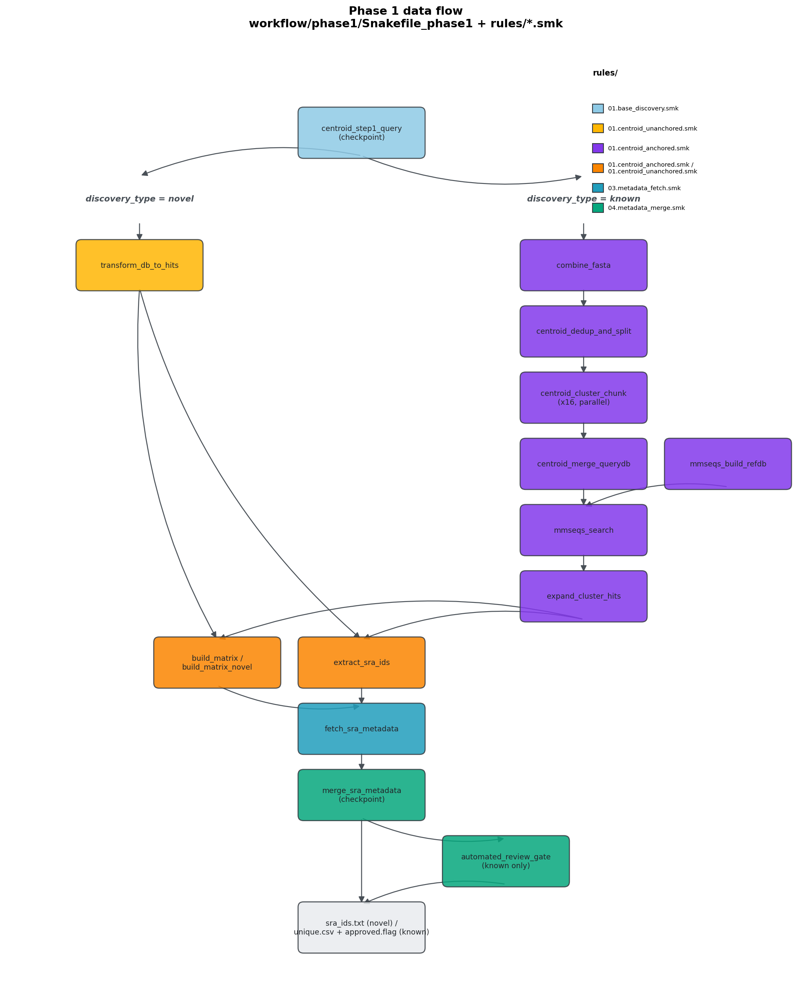
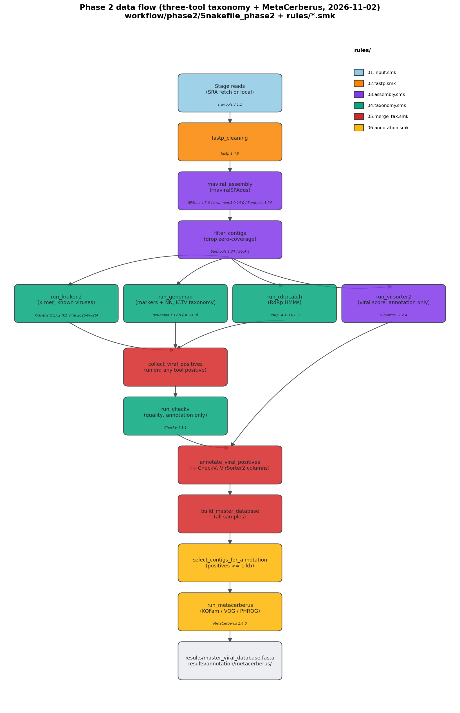

# A Hitchhiker's Guide to Virus Discovery

Modular [Snakemake](https://snakemake.github.io/) workflows for large-scale RNA virus discovery in public Sequence Read Archive (SRA) datasets and local sequencing libraries, designed for unprivileged HPC clusters (SLURM + per-rule Conda/Mamba environments).

The repository provides two decoupled phases:

| Workflow | Entry Point | Purpose | Can run standalone? |
| :--- | :--- | :--- | :---: |
| **Phase 1 — Discovery Scenarios** | `workflow/phase1/Snakefile_phase1` | Screens SRA runs via Serratus/Logan across four discovery modes (`novel`, `surrogate`, `host_expansion`, `geographic`), fetches NCBI SRA metadata, and applies an automated review gate. | Yes |
| **Phase 2 — Assembly & Annotation** | `workflow/phase2/Snakefile_phase2` | Stages SRA or local FASTQ reads from a CSV manifest, trims (`fastp`), assembles (`rnaviralSPAdes` / long-read modes), classifies with three independent tools (`Kraken2`, `geNomad`, `RdRpCATCH`), and annotates (`CheckV`, `MetaCerberus`, ICTV VMR). | **Yes** (no Serratus required) |

---

## Repository Map

```text
.
├── workflow/
│   ├── phase1/
│   │   ├── Snakefile_phase1          # Phase 1 Snakemake entry point
│   │   ├── submit_phase1.sh          # SLURM driver script
│   │   ├── configs/                  # Discovery scenario and path configs
│   │   ├── rules/                    # Screening, MMseqs2 anchoring, metadata merge & review gate
│   │   ├── envs/                     # Pinned per-rule Conda environments
│   │   └── scripts/                  # SRA metadata and sOTU helper scripts
│   └── phase2/
│       ├── Snakefile_phase2          # Phase 2 Snakemake entry point (runnable standalone)
│       ├── submit_phase2.sh          # SLURM driver script (3 stages)
│       ├── submit_phase2_stage3.sh   # Stage 3 only: master viral DB + MetaCerberus
│       ├── setup_databases.sh        # Idempotent external database downloader (~35–50 GB)
│       ├── SETUP.md                  # Detailed reference database setup guide
│       ├── configs/paths.yaml        # Database and manifest path configuration
│       ├── rules/                    # Modular rules (00.setup … 08.ictv)
│       ├── envs/                     # Pinned per-rule Conda environments
│       └── scripts/                  # Manifest intake, read staging, taxonomy merging
├── plots/                            # Phase 1 and Phase 2 workflow diagrams
├── tests/                            # Fast repository hygiene and portability tests
├── CITATION.cff                      # Machine-readable citation metadata
└── LICENSE                           # GPL-3.0 License
```

---

## Quickstart

### Prerequisites
- Snakemake 8.x (`snakemake --version`) and Conda/Mamba (`miniforge` / `micromamba`).
- Optional: SLURM (`sbatch`) for cluster execution (edit `module load snakemake/...` in the `submit_*.sh` scripts if your cluster uses a different module name or Conda activation).

### 1. Provision External Reference Databases (Phase 2)
Reference databases are never bundled in git. Provision them once to a shared or scratch directory (see [workflow/phase2/SETUP.md](workflow/phase2/SETUP.md)):

```bash
cd workflow/phase2
./setup_databases.sh /path/to/your/database_root
```

### 2. Run Phase 1 — SRA Discovery Scenarios


1. Set `current_mode` (`novel`, `surrogate`, `host_expansion`, or `geographic`) and target family/anchor taxon in `workflow/phase1/configs/phase1_sra_discovery.yaml`.
2. Submit or run locally:
   ```bash
   cd workflow/phase1
   sbatch submit_phase1.sh
   # Optional email notifications: sbatch --mail-user=you@example.org submit_phase1.sh
   ```

### 3. Run Phase 2 — Assembly, Taxonomy & Annotation (Standalone or Post-Phase 1)


Point `manifest:` in `workflow/phase2/configs/paths.yaml` at a CSV manifest (either produced by Phase 1 or custom-built for SRA and/or local FASTQ files):

```csv
sample_id,family,source,run_id,fq1,fq2,platform,layout
SRR12345678,Hepeviridae,sra,SRR12345678,,,illumina,paired
my_local_sample,Hepeviridae,local,,reads/sample_R1.fastq.gz,reads/sample_R2.fastq.gz,illumina,paired
```

Then run:
```bash
cd workflow/phase2
sbatch submit_phase2.sh
```

---

## Validation & Reproducibility

Run the fast repository hygiene checks locally (no HPC or external databases required):

```bash
python3 -m unittest discover -s tests -v
```

- **External data only:** Raw reads, reference databases, container images (`*.sif`), cluster logs, and generated outputs are gitignored.
- **Portable cluster wrappers:** All SLURM scripts resolve caches via `${XDG_CACHE_HOME:-$PWD/.cache}` and `${PIP_CACHE_DIR:-$PWD/.cache/pip}` and contain no hardcoded personal email addresses or home paths.

## License & Citation

Licensed under the GNU General Public License v3.0 ([LICENSE](LICENSE)). Citation metadata is provided in [CITATION.cff](CITATION.cff).
